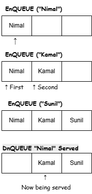

# Colombo Shoe Fair – Booking System (Python)

A console-based booking system for a shoe fair. It manages the product catalogue,
customer orders, on-site and online payments, and revenue reporting.

## Features
- View the shoe catalogue with prices
- Create bookings with customer details and payment method
- Add items to an existing on-site order
- Search orders by order number
- Process payments and update revenue totals
- Revenue report with payment breakdown and pending orders

## Data structures and design
- **Dictionaries** for the item catalogue and orders database (fast lookup by code or order number)
- **Classes** for `ItemRecord`, `OrderItemRecord`, `OrderRecord`, `OrderNumberGenerator` and `RevenueSummary`
- **Business rules:** 3% processing fee on online payments only; on-site orders can be edited until paid

## Queue concept

[Describe the queue here, e.g. "The diagram shows a first-in, first-out queue for serving customers.
This is the model for [describe]. It is shown as a design concept and is not implemented in the code."]

## How to run
1. Install Python 3.8 or newer from python.org.
2. Download `colombo_shoe_fair_booking.py`.
3. Run `python colombo_shoe_fair_booking.py` in a terminal.

## Example
Main menu options 1–7 include viewing items, creating a booking, and generating the revenue report.

## Tools
Python 3 · [IDE used, e.g. VS Code] · draw.io (diagram)

## What I'd improve next
- Save orders to a file or database so they survive restarts
- Add a queue to serve customers in order
- Add input validation tests
